# Architecture

```mermaid
classDiagram
    direction TB

    namespace Interfaces {
        class EcosystemManager {
            <<interface>>
            +str ecosystem
            +str type
            +str label
            +tuple total_keys
            +EcosystemParser parser
            +EcosystemRegistry registry
            +EcosystemOutput output
            +packages_to_fetch(parsed, tree, cve_packages) Any
            +summarize(result) dict
            +write_result(cfg, result, log_dir)
            +analyze(cfg, manager, log_dir, cve_packages) dict
        }

        class EcosystemParser {
            <<interface>>
            +parse(file_path) Any
            +resolve_tree(file_path, parsed, cfg, log_dir) Any
        }

        class EcosystemRegistry {
            <<interface>>
            +fetch_versions(packages, cfg) Any
        }

        class EcosystemOutput {
            <<interface>>
            +apply_updates(parsed, tree, versions, cve_packages, cfg) EcosystemUpdateResult
            +write_logs(log_dir, result)
        }

        class EcosystemUpdateResult {
            <<dataclass>>
            +list display_changes
            +list skipped_display
            +dict extra
        }
    }

    namespace Runner {
        class run_analysis {
            <<pipeline/runner.py>>
            run_analysis(manager, file_path, log_dir, cve_packages, cfg) dict
        }
    }

    namespace NpmEcosystem {
        class NpmManager {
            +ecosystem = "npm"
            +type = "node"
            +total_keys = npm_direct, npm_override, skipped
        }
        class NpmParser {
            +parse(file_path) NpmParsed
            +resolve_tree(...) NpmTree
        }
        class NpmRegistry {
            +fetch_versions(NpmFetchRequest, cfg) NpmVersionSet
        }
        class NpmOutput {
            +apply_updates(...) EcosystemUpdateResult
            +write_logs(log_dir, result)
        }
    }

    namespace GradleEcosystem {
        class GradleManager {
            +ecosystem = "maven"
            +type = "gradle"
            +total_keys = gradle_direct, gradle_force, skipped
        }
        class GradleParser {
            +parse(file_path) GradleParsed
            +resolve_tree(...) GradleTree
        }
        class GradleRegistry {
            +fetch_versions(deps, cfg) GradleVersionSet
        }
        class GradleOutput {
            +apply_updates(...) EcosystemUpdateResult
            +write_logs(log_dir, result)
        }
    }

    namespace PythonEcosystem {
        class PythonManager {
            +ecosystem = "pypi"
            +type = "python"
            +total_keys = python_direct, skipped
        }
        class PythonParser {
            +parse(file_path) PythonParsed
            +resolve_tree(...) None
        }
        class PythonRegistry {
            +fetch_versions(packages, cfg) PythonVersionSet
        }
        class PythonOutput {
            +apply_updates(...) EcosystemUpdateResult
            +write_logs(log_dir, result)
        }
    }

    EcosystemManager o-- EcosystemParser : parser
    EcosystemManager o-- EcosystemRegistry : registry
    EcosystemManager o-- EcosystemOutput : output
    EcosystemOutput ..> EcosystemUpdateResult : returns
    run_analysis --> EcosystemManager : orchestrates

    NpmManager ..|> EcosystemManager
    NpmManager o-- NpmParser
    NpmManager o-- NpmRegistry
    NpmManager o-- NpmOutput

    GradleManager ..|> EcosystemManager
    GradleManager o-- GradleParser
    GradleManager o-- GradleRegistry
    GradleManager o-- GradleOutput

    PythonManager ..|> EcosystemManager
    PythonManager o-- PythonParser
    PythonManager o-- PythonRegistry
    PythonManager o-- PythonOutput
```



# Validation & Verification Layer

Once `EcosystemOutput.apply_updates` produces a result, `manager.write_result` hands
off to a shared write/validate/verify pipeline that every ecosystem goes through the
same way — this is where Success / Partial / Manual-Update-Required is actually
decided.

```mermaid
classDiagram
    direction TB

    namespace WriteValidate {
        class run_write_validate {
            <<pipeline/runner.py>>
            run_write_validate(plan) bool
        }
        class WritePlan {
            <<dataclass>>
            +bool has_changes
            +str file_path
            +Callable write
            +Callable validate
        }
        class validate_or_rollback {
            <<shared/build_validation/core.py>>
            validate_or_rollback(path, original, current, failure, candidates, build_fn, revert_fn, confirm_fn, ...)
            ecosystem-agnostic; shared/build_validation/{gradle,node,python}.py
            hold the ecosystem-specific validate_*_project_or_rollback callers
        }
        class BuildValidationManualUpdatesError {
            <<exception>>
            raised when no revert set restores a passing build
        }
    }

    namespace Isolation {
        class _run_candidate_trials {
            rank candidates by relevance to failure text
            try_step_down() intermediate versions first
            fall back to full single-package revert
            accumulate reverts until build passes
        }
        class _gradle_baseline_failure {
            Gradle only: rebuild with the ORIGINAL file
            same failing test(s)? -> keep updates, don't roll back
        }
    }

    namespace Verification {
        class finalize_verification {
            <<shared/verification.py>>
            finalize_verification(results) dict
        }
        class run_discovered_tests {
            rerun tests per changed file
            node: rerun tests against pre-remediation package.json (git HEAD);
            same failing suite there -> treat as pre-existing, not a regression
            gradle: compare against build-validation-preexisting-failures.csv
        }
        class refresh_dependency_evidence {
            re-resolve dependency tree post-write
            flags silent tree-resolution failure (tree_failed)
        }
    }

    namespace Phase2 {
        class run_phase2_results {
            <<quick_update.py>>
            replay cached write/validate plans with
            enable_failure_isolation=True
            re-clones the checkout if the recorded
            file_path no longer exists on disk
        }
    }

    run_write_validate --> WritePlan : executes
    WritePlan ..> validate_or_rollback : validate()
    validate_or_rollback --> _run_candidate_trials : on build failure
    validate_or_rollback --> _gradle_baseline_failure : gradle, on first failure
    validate_or_rollback --> BuildValidationManualUpdatesError : no candidate works
    finalize_verification --> run_discovered_tests
    finalize_verification --> refresh_dependency_evidence
    run_phase2_results --> WritePlan : make_write_plan(cfg, cached_result, log_dir)
```

**Success / Partial / Manual-Update-Required is computed once**, in
`shared/verification.py::finalize_verification`, and `shared/report.py`'s Overall
Status badge reads that same `outcome` field — CSV-file presence is only a fallback
for when verification itself couldn't run.

