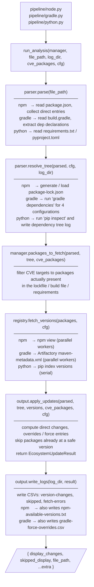
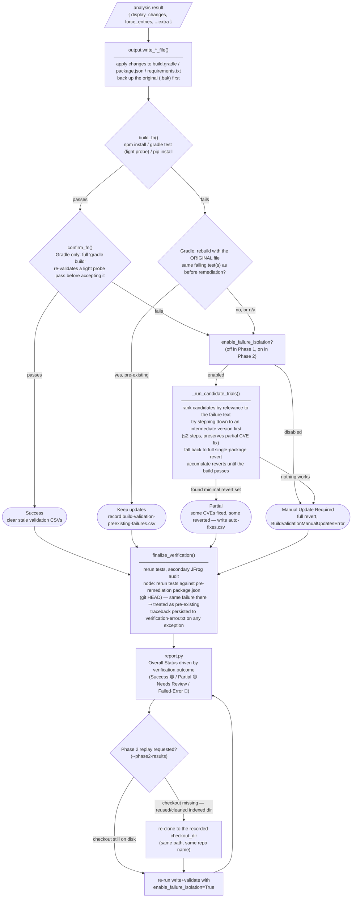
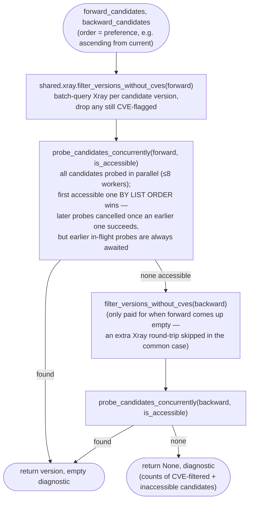
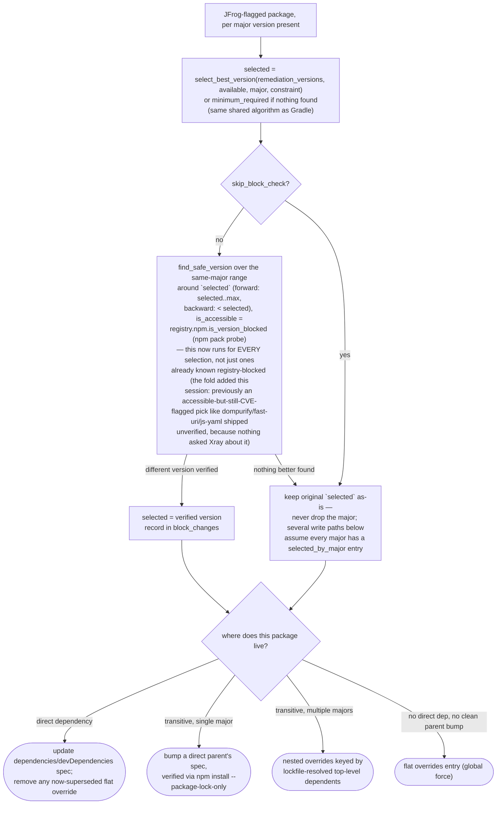
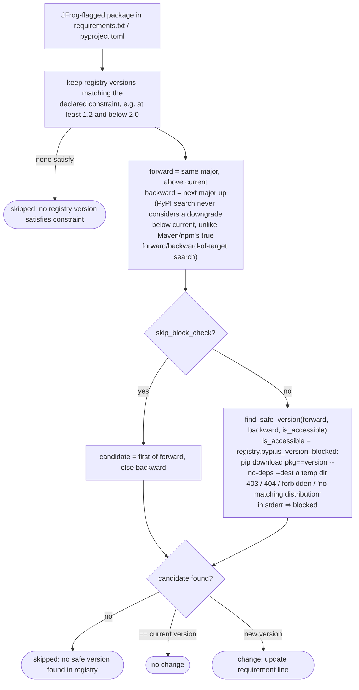

# Pipeline Flow

# Write, Validate & Rollback

# Version Determination

How `APPLY` (`output.apply_updates`) picks the actual version number for a flagged
package. All three ecosystems share the same underlying safety check
(`shared.version_search.find_safe_version`); each just builds its own candidate
lists and its own `is_accessible` probe around it.

## Shared core: `find_safe_version`

## Gradle (`output/gradle.py::apply_updates`)

```mermaid
flowchart TD
    KEY["JFrog-flagged package (group:artifact)"] --> TARGET["target = select_best_version(remediation_versions, available, major, constraint, current)\nsame-minor-first if remediation mentions the current\nminor line, else same-major; never crosses major;\nconstraint '>' picks the LOWEST candidate above current\n(minimal safe bump, not latest)"]

    TARGET --> ACCESS0{"skip_block_check?"}
    ACCESS0 -->|no| PROBE0["find_accessible_version(group, artifact, target, available, ...)\n= find_safe_version with forward: same major, ≥ target (top 10, no prereleases)\nbackward: same major, < target (top 10)\nis_accessible = registry.maven.version_accessible:\nHEAD .module (403 ⇒ definitely blocked) →\nGET .jar streamed, status only (NOT HEAD —\nXray's download-policy block only fires on a\nreal GET, confirmed live on jackson-databind) →\nGET .pom, accept only if packaging=pom (BOM/parent)"]
    PROBE0 -->|none accessible| SKIPT(["skipped: no accessible version found >= target"])
    PROBE0 -->|found| TARGET2["target = accessible version"]
    ACCESS0 -->|yes| TARGET2

    TARGET2 --> DIRECT{"key in direct_by_key?\n(declared in build.gradle)"}

    DIRECT -->|yes: Case 1| OCC["patch EVERY parsed occurrence of this\ngroup:artifact in the file — not just the first\n(a build.gradle can declare the same artifact twice;\nthe writer used to only patch the first textual match)"]
    OCC --> CHANGE(["change: direct dependency edit"])

    DIRECT -->|no| PARENT{"parents_of[key] non-empty?\n(Case 2: transitive)"}
    PARENT -->|yes| CASE2["resolve_transitive_with_gradle:\nbump ONE parent, highest-version candidate first,\nreal 'gradle dependencies' in a temp copy;\ncapped at 1 probe total across ALL parents for this\nkey (0/275 lower candidates ever succeeded in real\nbatch data — trying more just burned ~40-60s each)"]
    CASE2 -->|resolves it| CHANGE
    CASE2 -->|fails| CASE3
    PARENT -->|no| CASE3["Case 3: resolutionStrategy.force entry"]
    CASE3 --> FORCE(["force entry"])

    CHANGE --> SIBLING
    FORCE --> SIBLING["_sibling_family_forces:\nany OTHER same-group artifact currently at the\nEXACT SAME resolved version as the one just changed\nis treated as version-locked and forced to match —\nbut ONLY to a version confirmed to exist for THAT\nsibling (checked against available_by_key); falls back\nto the closest existing version below the trigger's\ntarget, or skips the sibling entirely if nothing exists\n(jackson-annotations has no patch releases, so it can't\njust inherit jackson-databind's exact '2.22.1')"]
    SIBLING --> COMPETE["_align_competing_pins:\nre-scan the WHOLE file for any other declaration\n(strict version block or resolutionStrategy.force line)\nof a package now in changes/force_entries that's\nstill pinned to something else — realign it too"]
    COMPETE --> WRITE(["write_gradle_file: changes, then forces, then\nSpring Boot managed properties / plugin version /\ndependency substitutions"])
```

## Node (`output/node.py::apply_updates`)

## Python (`managers/python.py::apply_updates`)

