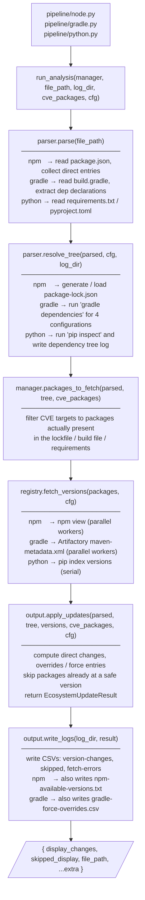

# Pipeline Flow



# Write, Validate & Rollback

```mermaid
flowchart TD
    OUT[/"analysis result\n{ display_changes, force_entries, ...extra }"/] --> WRITE["output.write_*_file()\n─────────────────────\napply changes to build.gradle / package.json / requirements.txt\nback up the original (.bak) first"]

    WRITE --> BUILD1{"build_fn()\nnpm install / gradle test (light probe) / pip install"}

    BUILD1 -->|passes| CONFIRM{"confirm_fn()\nGradle only: full 'gradle build'\nre-validates a light probe pass before accepting it"}
    CONFIRM -->|passes| SUCCESS(["Success\nclear stale validation CSVs"])
    CONFIRM -->|fails| ISOL

    BUILD1 -->|fails| BASELINE{"Gradle: rebuild with the ORIGINAL file\nsame failing test(s) as before remediation?"}
    BASELINE -->|yes, pre-existing| KEEP(["Keep updates\nrecord build-validation-preexisting-failures.csv"])
    BASELINE -->|no, or n/a| ISOL

    ISOL["enable_failure_isolation?\n(off in Phase 1, on in Phase 2)"] -->|disabled| MANUAL(["Manual Update Required\nfull revert, BuildValidationManualUpdatesError"])
    ISOL -->|enabled| TRIALS["_run_candidate_trials()\n─────────────────────\nrank candidates by relevance to the failure text\ntry stepping down to an intermediate version first\n(≤2 steps, preserves partial CVE fix)\nfall back to full single-package revert\naccumulate reverts until the build passes"]

    TRIALS -->|found minimal revert set| PARTIAL(["Partial\nsome CVEs fixed, some reverted — write auto-fixes.csv"])
    TRIALS -->|nothing works| MANUAL

    SUCCESS --> VERIFY
    KEEP --> VERIFY
    PARTIAL --> VERIFY
    MANUAL --> VERIFY["finalize_verification()\n─────────────────────\nrerun tests, secondary JFrog audit\nnode: rerun tests against pre-remediation package.json\n(git HEAD) — same failure there ⇒ treated as pre-existing\ntraceback persisted to verification-error.txt on any exception"]

    VERIFY --> REPORT["report.py\nOverall Status driven by verification.outcome\n(Success 🟢 / Partial 🟡 Needs Review / Failed·Error 🔴)"]

    REPORT --> PHASE2{"Phase 2 replay requested?\n(--phase2-results)"}
    PHASE2 -->|checkout still on disk| REPLAY["re-run write+validate with\nenable_failure_isolation=True"]
    PHASE2 -->|checkout missing\n(reused/cleaned indexed dir)| RECLONE["re-clone to the recorded checkout_dir\n(same path, same repo name)"] --> REPLAY
    REPLAY --> REPORT
```
